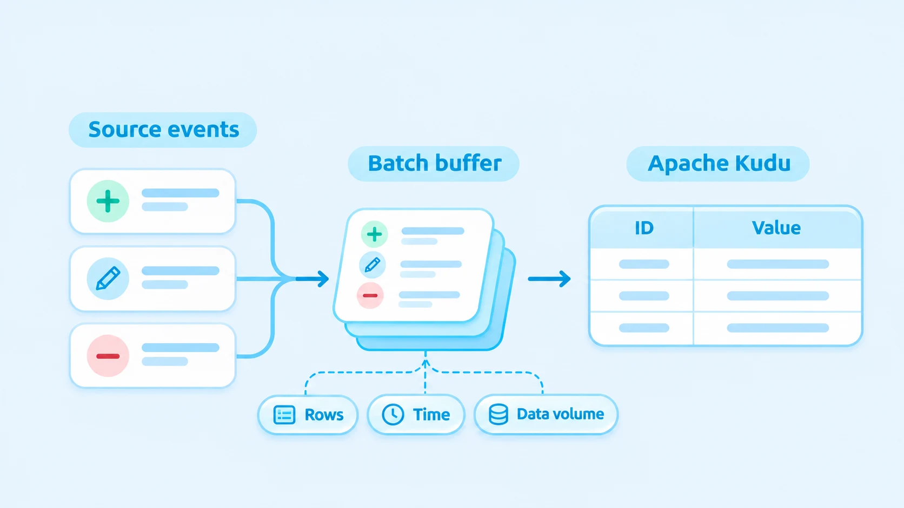
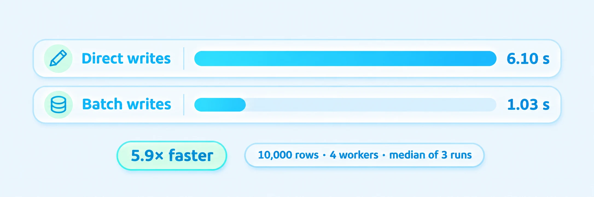
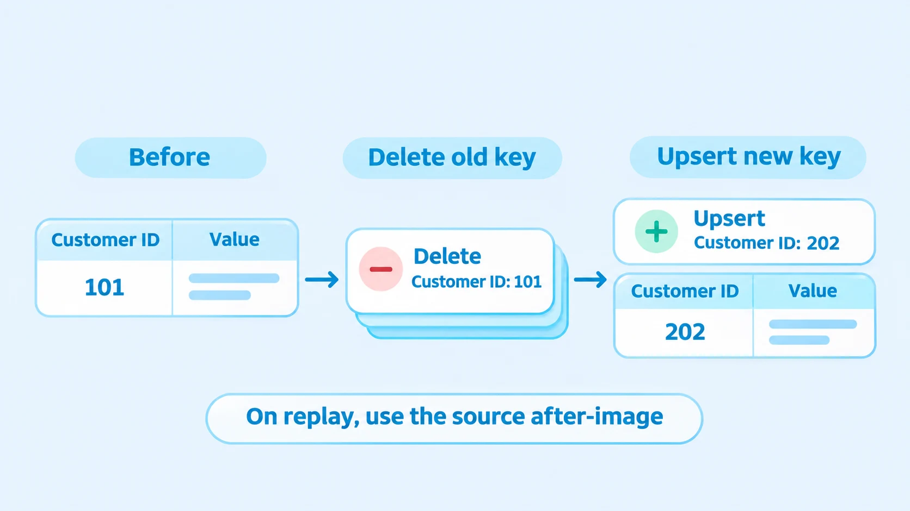

Keeping a Kudu analytics platform up to date takes more than an initial data load. Teams also need to synchronize ongoing data changes, keep target schemas aligned, and resume synchronization after interruptions.

[BladePipe 1.12.0](/docs/releaseNote/rn-bladepipe-1-12-0) expands Apache Kudu target support with batch writes, incremental DDL, interruption recovery, and data verification and correction. These capabilities cover the workflow from initial migration to continuous synchronization.

## Batch Writes for Faster Incremental Sync

BladePipe combines small changes into batches and submits them when a configured row-count, time, or data-volume threshold is reached. Batch writes are enabled by default for new jobs through `enableBatchWrite`.

In a 10,000-row incremental sync benchmark with four workers, the median completion time across three runs decreased from about **6.10 seconds to 1.03 seconds** with batch writes—a **5.9× speedup in this test**. Results vary with the workload and deployment.

## From Initial Migration to Ongoing CDC

BladePipe supports schema migration, full migration, and incremental sync to Kudu. It can create target tables from source metadata and mapping rules, load existing records, and then synchronize ongoing INSERT, UPDATE, and DELETE operations.

Source primary-key changes are also supported, helping teams keep Kudu data aligned as source records change.

Before a full migration, you can choose to drop and recreate the target tables so the reload starts with the current schema and a clean target.

## Incremental DDL for Schema Changes

BladePipe supports these DDL operations during incremental sync to Kudu:

- Create and drop tables
- Add and drop columns
- Rename tables and columns
- Set and remove default values
- Synchronize table and column comments

Supported schema changes can flow through the synchronization pipeline, helping keep Kudu tables aligned with the source. Available DDL operations depend on the source database and Kudu server version.

## Recovery After Interruptions

BladePipe supports checkpoint-based recovery after network interruptions and job restarts. Once a job resumes, it can continue processing changes from its saved checkpoint, including changes made while the job was stopped.

Replay handling helps restore synchronization after partially completed writes. Recovery scenarios have been verified for both Oracle primary-to-Kudu and Oracle Data Guard-to-Kudu pipelines.

## Data Verification and Correction

Data verification compares source and target data to identify differences. Data correction can then address the inconsistencies found, helping teams check and restore data consistency after migration or during ongoing synchronization.

Together with migration and incremental sync, verification and correction give teams a way to maintain data in Kudu throughout the synchronization workflow.

## FAQs

### Can BladePipe sync a relational database to Apache Kudu?

Yes. BladePipe supports schema migration, full migration, and incremental sync to Kudu, so you can load existing data and then keep it up to date.

### Does BladePipe support batch writes to Kudu?

Yes. BladePipe can batch changes across multiple events. It submits the batch when the configured row-count, elapsed-time, or data-volume threshold is reached. Batch writes are enabled by default for new jobs.

### How much faster is Kudu incremental sync with batch writes?

In a 10,000-row test with four workers, batch writes completed in about 1.03 seconds, compared with 6.10 seconds without batching—a 5.9× speedup in that test.

## Get Started

Upgrade to BladePipe 1.12.0 to use the expanded Kudu synchronization capabilities, from faster batch writes and incremental schema changes to recovery, verification, and correction.

- **Existing users:** [Upgrade BladePipe with Docker](https://www.bladepipe.com/docs/productOP/onPremise/installation/upgrade_all_in_one_docker/)
- **New users:** [Install BladePipe with Docker](https://www.bladepipe.com/docs/productOP/onPremise/installation/install_all_in_one_docker/)
