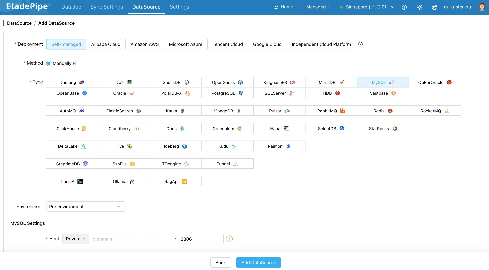
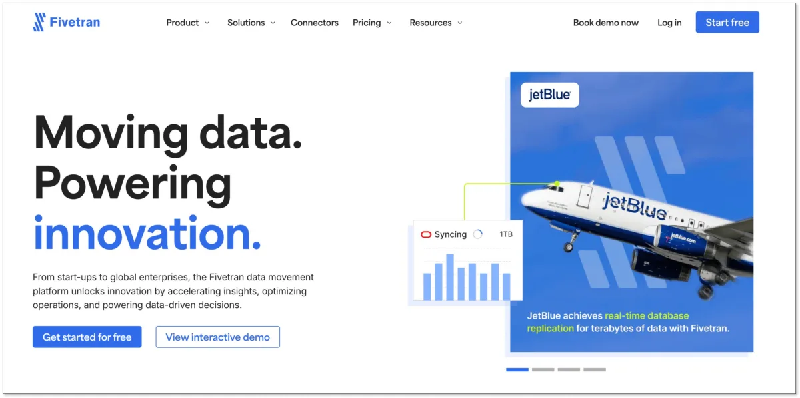
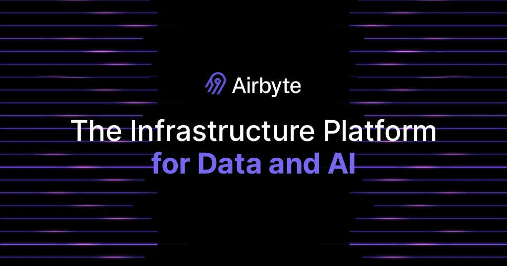
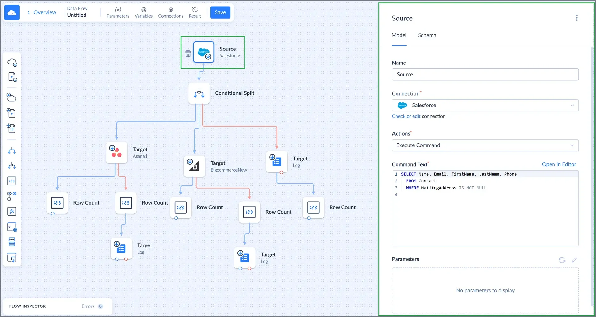
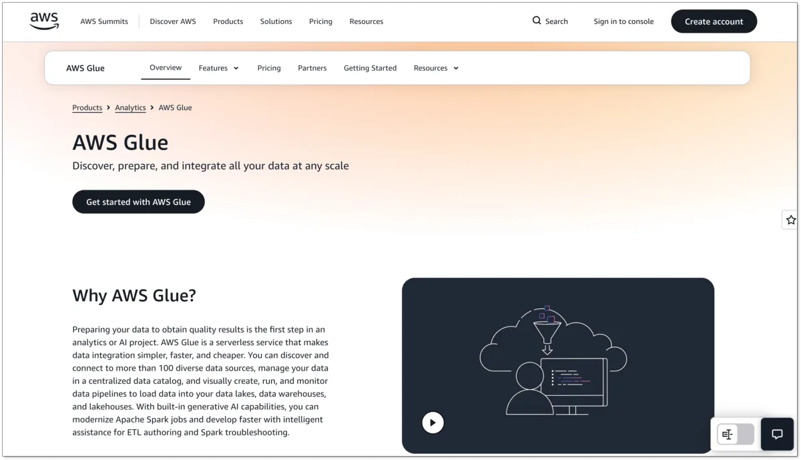
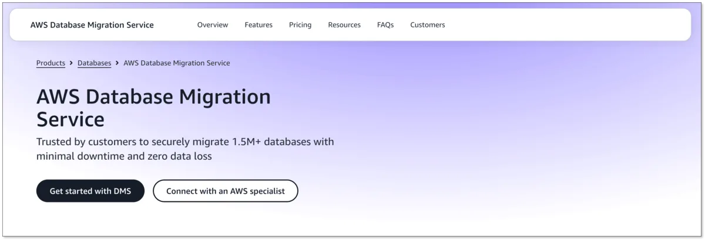
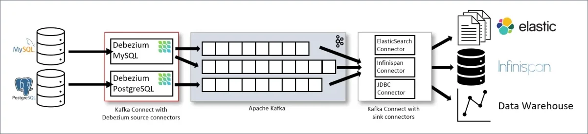
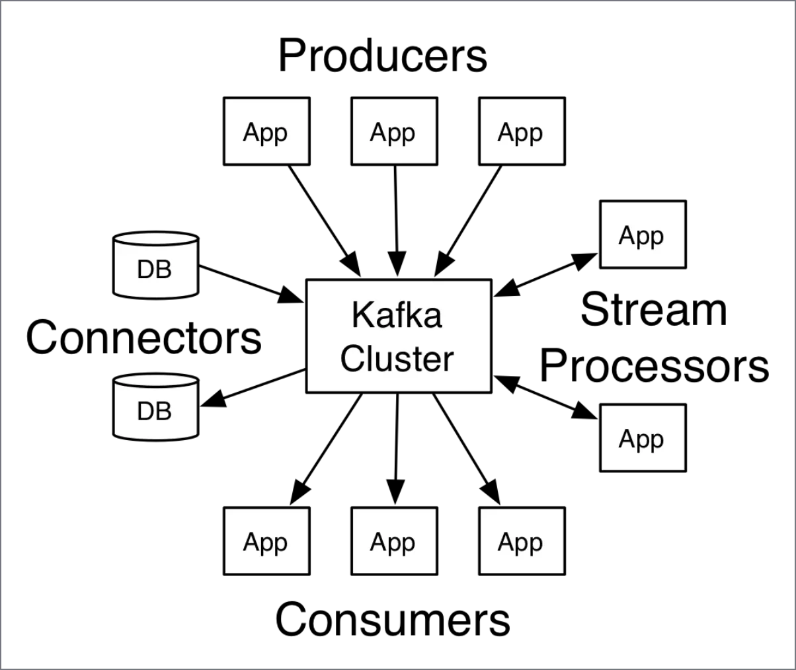
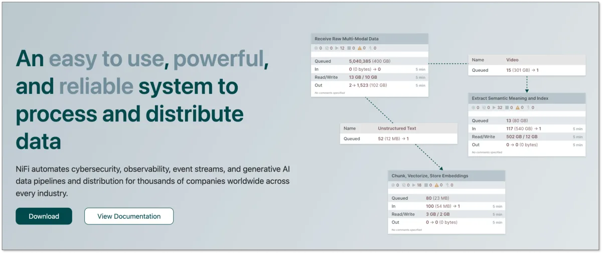
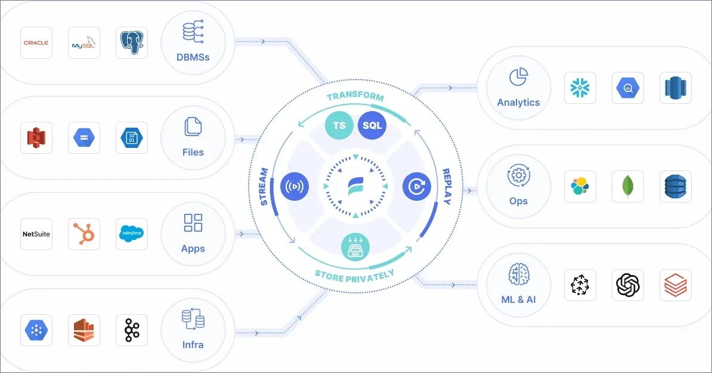

Choosing a data ingestion tool starts with three questions: where does the data come from, where must it go, and how fresh does it need to be? This guide compares 10 products to help find the best platform for managed ELT, CDC, database migration, and event-streaming workloads.

<!-- truncate -->

## What Are Data Ingestion Tools?

**Data ingestion tools** are software that collect or capture data from sources such as databases, SaaS applications, files, APIs, and event streams, then deliver it to a destination for storage or downstream use. Data ingestion is collecting data from sources and copying it to a target system. Tools automate that movement through batch, incremental, CDC, or streaming methods; some also validate or transform data, but ingestion does not always include the full transformation step in [ETL](etl_steps_explained.md).

## 10 Data Ingestion Tools Compared

These data ingestion solutions cover managed SaaS ingestion, database replication and migration, cloud ETL, open-source CDC, event streaming, and flow-based integration. We compare the tools from five perspectives: route fit, update behavior, deployment, operating effort, and [pricing model](#how-do-data-ingestion-tools-compare-on-pricing).

| Tool | Typical source → destination fit | Update method and freshness | Deployment | Operating effort |
| --- | --- | --- | --- | --- |
| **BladePipe** | Supported database, messaging, and analytics [source-to-target routes](https://www.bladepipe.com/connector/) | Initial full load followed by continuous incremental sync (CDC); typical latency below 3 seconds | Managed cloud, BYOC worker, or on-premises | Low: visual setup with supported connectors, DataJob monitoring, and configurable alerts |
| **Fivetran** | SaaS applications and databases to analytics destinations | Initial historical sync, then scheduled incremental syncs; cadence and capture method vary by connector | Managed service; hybrid deployment is available for supported connectors | Low: provider operates connectors; team still handles connector settings, access, and resyncs |
| **Airbyte** | SaaS applications and databases to supported destinations, including warehouses | Full refresh or incremental; log-based CDC only for supported connector pairs | Managed cloud or self-managed | Managed: low effort; self-managed: team handles upgrades, scaling, monitoring, and incident response |
| **Skyvia** | Supported SaaS applications and databases to supported apps, databases, and warehouses | Scheduled import/replication; full copy followed by incremental changes for supported objects | Managed cloud service | Low: visual setup; source API limits, unsupported objects, and plan-dependent schedules can restrict sync coverage and frequency |
| **AWS Glue** | AWS-centered data lakes and analytics, plus supported external stores | Batch ETL and event-triggered jobs; streaming jobs for supported sources | Serverless AWS service | Medium: AWS runs the compute, while the team builds jobs and owns permissions, networking, triggers, and monitoring |
| **AWS Database Migration Service** | Supported database endpoints, especially for AWS-centered migrations | Full load, CDC, or full load plus CDC; CDC is not real-time and has no latency SLA | AWS-managed replication instance or Serverless capacity | Medium: AWS runs the replication capacity; the team configures endpoints, tasks, sizing, and monitoring |
| **Debezium** | Database changes into Kafka topics and downstream consumers or sinks | Log-based CDC; millisecond-range on MySQL and PostgreSQL, depending on connector and runtime | Self-managed Kafka Connect or Debezium Server | High: operate the runtime and plan for offsets, schema history, topics, and recovery |
| **Apache Kafka** | Applications publish events to Kafka; Kafka Connect moves data between Kafka and external systems | Continuous event delivery with retention; Kafka Connect or another extractor is needed for external sources | Self-managed cluster or a managed Kafka service | High: operate or pay for the broker service, then manage connectors, schemas, retention, and recovery |
| **Apache NiFi** | Sources and targets with an available NiFi processor, such as files, databases, and APIs | Configurable scheduled, event-driven, and continuous flows; cadence depends on flow design | Self-managed flow platform | Medium–high: visual controls help inspect flows, but teams own capacity, failure handling, upgrades, and flow maintenance |
| **Estuary** | Supported SaaS, database, file, and stream sources to configured destinations | Batch, log-based CDC, and streaming; destinations can use independent delivery schedules | Public SaaS, private data plane, or BYOC | Low–medium: Estuary operates the runtime; teams configure supported source and destination connectors and monitor pipeline health |

For tools that also orchestrate, transform, or manage broader pipeline workflows, see our guide to [data pipeline tools](best_data_pipeline_tools.md).

### 1. BladePipe: database CDC and continuous synchronization

[BladePipe](https://www.bladepipe.com/) is a CDC-based data ingestion platform that combines [**full data migration**](best_data_migration_tools.md) with ongoing [**change data capture (CDC)**](change_data_capture_cdc.md) synchronization for supported database, messaging, and analytics routes. Its documented capabilities include **schema evolution** and **data verification and correction**. It can run an initial full load, keep the target updated through CDC, and verify or correct data after loading.

**Best fit:** Database-to-database or database-to-analytics pipelines that need an initial full load followed by ongoing CDC and optional data verification.

**Trade-off to evaluate:** Connector coverage is route-specific. Verify the source and target pairing, versions, CDC prerequisites, permissions, and deployment mode in the [connector list](https://www.bladepipe.com/connector/). For SaaS API sources, compare Fivetran, Airbyte, and Skyvia by app and object coverage and sync frequency.

### 2. Fivetran: managed connector-based ELT

[Fivetran](https://fivetran.com/) is a managed data ingestion service for moving application and database data into analytics destinations. Its documentation describes an **initial historical sync** followed by **incremental syncs** where supported; exact sync behavior and supported modes vary by connector.

**Best fit:** Teams that need recurring SaaS or database syncs to analytics destinations and want Fivetran to operate the connectors.

**Trade-off to evaluate:** Check the specific connector's sync frequency, incremental method, delete handling, and historical backfill behavior.

### 3. Airbyte: connector choice and deployment flexibility

[Airbyte](https://airbyte.com/) is a connector-based data ingestion platform with managed and self-managed deployments. It supports **full refresh, incremental, and log-based CDC** for supported connectors; those features are not uniform across every source and destination.

**Best fit:** Teams choosing between managed and self-hosted deployment, building custom connectors, or using CDC on supported source-destination pairs.

**Trade-off to evaluate:** Confirm the implementation and maintenance status of each connector, not just whether it appears in the catalog. For self-managed deployments, include upgrades, scaling, monitoring, and incident response in the total cost. For CDC, check source prerequisites, primary-key constraints, and how deletes appear downstream.

### 4. Skyvia: low-code cloud data integration

[Skyvia Data Integration](https://skyvia.com/) offers a low-code data ingestion service with **import/export, cloud app replication, synchronization, and multi-source data flows**. Its replication documentation describes an initial full copy followed by incremental updates for supported objects, including inserted, updated, and deleted records.

**Best fit:** Teams that need visual import, export, replication, or synchronization for supported cloud apps and databases.

**Trade-off to evaluate:** Incremental updates and schema behavior vary by object and connector. Confirm support for the exact database, SaaS objects, direction, transformation, and schedule. Test API limits and deleted-record handling with representative data before relying on it for production freshness.

### 5. AWS Glue: AWS-centered ETL and data preparation

[AWS Glue](https://aws.amazon.com/glue/) is a serverless data ingestion and ETL service for **discovering, preparing, moving, and transforming data**. It includes a **Data Catalog** and **ETL job tooling** and integrates with AWS analytics services and data lakes. It is broader than a simple source-to-destination connector.

**Best fit:** Teams building data lake or analytics pipelines primarily on AWS, especially when cataloging and transformation are part of the workload.

**Trade-off to evaluate:** You still need to design jobs, permissions, networking, triggers, and monitoring for your workflow. Estimate runtime and data transfer costs for real job sizes. For database migration or ongoing database replication, compare AWS DMS directly rather than assuming Glue is the same tool category.

### 6. AWS Database Migration Service: database migration and replication

[AWS DMS](https://aws.amazon.com/dms/) is a database migration and ingestion service for supported source and target endpoints. It can combine a **full load with ongoing change replication**, and is especially relevant when the architecture already runs in AWS.

**Best fit:** Teams migrating between DMS-supported database endpoints or keeping a target updated with full load plus CDC, especially on AWS.

**Trade-off to evaluate:** AWS notes that DMS CDC does not guarantee real-time replication and has **no CDC latency SLA**; lag can reach several minutes or more depending on workload and resources. Endpoint-specific feature differences, task sizing, network setup, table mappings, and logging also affect results. It is not a general-purpose SaaS connector catalog.

### 7. Debezium: open-source database change capture

[Debezium](https://debezium.io/) is an open-source data ingestion component that captures database changes through **CDC source connectors**. In the common Kafka Connect setup, connector events are written to **Kafka topics** and **downstream sink connectors** or consumers move them onward.

**Best fit:** Engineering teams that want change events in Kafka, need to fan them out to several consumers, and can own the CDC runtime.

**Trade-off to evaluate:** Debezium is a CDC building block, not a fully managed end-to-end ingestion service by itself. Plan for Kafka Connect deployment, connector configuration, topic and schema management, monitoring, upgrades, and sink behavior. Source prerequisites and event semantics are connector-specific, so test them against the exact database version and workload.

### 8. Apache Kafka: event streaming backbone

[Apache Kafka](https://kafka.apache.org/) is a **durable event layer** for streaming data ingestion, storing and distributing streams of records. **Kafka Connect** is the separate integration framework commonly used to move data between Kafka and external systems.

**Best fit:** Architectures where multiple producers publish events and multiple consumers need durable, decoupled access to those events.

**Trade-off to evaluate:** Kafka alone does not configure every source extractor, sink, schema policy, or transformation your pipeline needs. Account for Kafka Connect connectors, broker operations, storage and retention, security, and recovery. If the requirement is simply scheduled database-to-warehouse loading, a managed connector may be simpler to operate. If you are deciding whether Kafka belongs in the architecture, see [when you need Kafka](do_you_really_need_kafka.md).

### 9. Apache NiFi: visual flow routing and control

[Apache NiFi](https://nifi.apache.org/) is a flow-based data ingestion platform that lets teams build and manage flows through **configurable processors and connections**. Its user guide documents monitoring, **data provenance**, and **back-pressure controls** for queues.

**Best fit:** Teams that need to visually connect source, processing, and destination steps, with queue back-pressure and data provenance for flow control and troubleshooting.

**Trade-off to evaluate:** NiFi is a platform your team must design and operate. Check processor support, cluster and deployment needs, security, queue sizing, and how flows will be versioned and maintained.

### 10. Estuary: managed pipelines across batch, CDC, and streaming

[Estuary](https://estuary.dev/) is a managed data ingestion platform for **log-based CDC, SaaS ingestion, batch, and streaming**. It captures **source history and ongoing changes** into collections, then delivers data to destinations on their **configured schedules**.

**Best fit:** Teams that need to capture source history and ongoing changes, then deliver data to destinations on separate schedules using batch, CDC, or streaming.

**Trade-off to evaluate:** Check that the source-destination pair is supported and choose public, private, or BYOC deployment based on your data residency needs.

## Which Data Ingestion Pattern Fits?

| Pattern | Use it when | Main trade-off |
| --- | --- | --- |
| Batch | Use batch data ingestion when scheduled updates are sufficient | Data is stale between runs |
| Incremental | You need periodic updates without reloading all records | Depends on reliable cursors or change detection |
| CDC | Database inserts, updates, and deletes need to flow downstream | Requires source configuration, log retention, and recovery planning |
| Streaming | Applications produce events for continuous processing or multiple consumers | Requires ownership of event delivery, schemas, and runtime operations |

CDC captures source changes; streaming describes continuous event delivery or processing. A CDC pipeline can publish changes to a streaming platform.

## How to Choose the Best Data Ingestion Tool?

Compare data ingestion platforms on four points:

- **Route fit:** For each data ingestion pipeline, verify the exact source, destination, direction, version, and [connector coverage](what_are_data_connectors.md).
- **Data behavior:** Check freshness, initial load, inserts/updates/deletes, and schema-change handling.
- **Operations:** Test recovery, lag visibility, alerts, and the effort required to maintain the pipeline.
- **Cost and controls:** Include usage, compute, infrastructure, support, security, and deployment requirements.

## How Do Data Ingestion Tools Compare on Pricing?

These data ingestion tools use different billing units; the table summarizes each pricing model and its main cost drivers.

| Tool | Public price reference | Include in the estimate |
| --- | --- | --- |
| BladePipe | Free Community: on-premises, up to 5 DataJobs; reactivate the license every 3 months ([plan details](https://www.bladepipe.com/docs/price/plans_diff/)). Cloud: $0.01 per million full-load rows and $10 per million incremental rows. Enterprise: prepaid on-premises license ([pricing](https://www.bladepipe.com/docs/price/product_price/)) | For paid plans, include initial load, incremental rows, verification/correction, schema operations, link count, and deployment mode ([pricing](https://www.bladepipe.com/docs/price/product_price/)) |
| Fivetran | Free: up to 500,000 MAR/month across connections per account. Paid: usage-based MAR, with a $5 base charge for each connection with 1–1M MAR ([pricing](https://www.fivetran.com/pricing)) | Distinct changed rows (MAR) by connection; separate activation and transformation usage. Some re-sync rows count as MAR; others are free ([MAR rules](https://fivetran.com/docs/core-concepts/usage-based-pricing)) |
| Airbyte | Standard: $20/month for 5 credits + $5 per extra credit; Plus: $189/month for 40 credits; Pro/Enterprise Flex: custom capacity pricing. Core is free to self-host ([pricing](https://airbyte.com/pricing)) | Credits from API rows or database/file GB (Standard/Plus); Data Worker capacity (Pro); hosting for self-managed Core ([pricing](https://airbyte.com/pricing)) |
| Skyvia | Free: 10,000 records/month, 2 scheduled integrations (expire after 30 days), once-daily runs. Basic: $99/month, or $79/month billed annually ([pricing](https://skyvia.com/pricing)) | Record allowance, scheduled integration count, and run frequency vary by plan ([pricing](https://skyvia.com/pricing)) |
| AWS Glue | Pay per DPU-hour for ETL jobs, crawlers, and interactive sessions; the Data Catalog includes 1 million objects and 1 million requests free each month. Rates vary by Region ([pricing](https://aws.amazon.com/glue/pricing/)) | DPU-hours, crawler runs, interactive sessions, Data Catalog use beyond the free allowance, and AWS Region ([pricing](https://aws.amazon.com/glue/pricing/)) |
| AWS DMS | Pay per replication instance-hour or Serverless DCU-hour; additional log storage and cross-AZ, cross-Region, or external data transfer may cost extra. Rates vary by Region ([pricing](https://aws.amazon.com/dms/pricing/)) | Region, instance/DCU hours, extra log storage, and cross-AZ/Region or external data transfer ([pricing](https://aws.amazon.com/dms/pricing/)) |
| Debezium | No software license fee for the Apache-licensed project | Kafka Connect or Debezium Server compute, Kafka if used, storage, monitoring, and on-call work ([license](https://debezium.io/license/)) |
| Apache Kafka | No software license fee for self-managed Apache Kafka; licensed under Apache 2.0 | Broker compute, storage and retention, network, managed-service fees if applicable, and operations ([license](https://github.com/apache/kafka/blob/trunk/LICENSE)) |
| Apache NiFi | No software license fee for the Apache project | Hosting, scaling, storage, monitoring, upgrades, and flow maintenance ([licensing guide](https://nifi.apache.org/documentation/guides/licensing/)) |
| Estuary | Free up to 10 GB/month and 2 connector instances; Cloud is $0.50/GB moved, plus $100/month per connector instance for the first six and $50/month for each additional instance. Private/BYOC uses custom annual pricing ([pricing](https://estuary.dev/pricing/)) | Volume is charged at capture and each delivery; connector instances are prorated hourly. Backfills are free for the first 30 days ([pricing](https://docs.estuary.dev/getting-started/pricing/)) |

Pricing and plan details are sourced from the linked official pages (accessed November, 2026). See the links for current prices and terms.

## Which Data Ingestion Tool Fits Which Workload?

| Workload | Start with | Why this is a reasonable shortlist |
| --- | --- | --- |
| Cloud data ingestion from SaaS apps to a warehouse, with minimal connector operations | Fivetran; compare Airbyte Cloud when its connector options or pricing model fit better | Both offer managed ingestion; compare the exact connector behavior and workload-based estimate. |
| Scheduled app/database integrations within plan limits | Skyvia | Its visual import, replication, and synchronization support scheduled runs within plan record and frequency limits. |
| AWS-centered lake ingestion, cataloging, and transformation | AWS Glue | Choose it when ETL jobs and the Data Catalog are part of an AWS analytics workflow. |
| Database migration or ongoing replication using supported AWS endpoints | AWS DMS | Use it when DMS supports both endpoints and its full-load/CDC modes meet the migration needs. |
| Database-to-database or database-to-analytics replication with an initial load followed by CDC | BladePipe | Its full-load plus CDC workflow supports both migration and ongoing synchronization; use verification when you need a consistency check. |
| Database changes published for several event-driven consumers | Debezium with Kafka Connect and Kafka | Debezium captures changes; Kafka Connect runs connectors; Kafka distributes and retains events. Budget for operating the stack. |
| Visual routing and control across mixed systems, especially in self-managed environments | Apache NiFi | Its processor-based flow canvas supports visual routing across systems with available processors. |
| Managed ingestion that combines batch, CDC, and streaming | Estuary | It captures source data once and delivers it to destinations on separate schedules. |

## FAQ

**Q1：Is data ingestion the same as ETL?**

No. Data ingestion tools collect and move data into a destination; ETL also transforms it before loading. Ingestion may be one stage of an ETL or ELT workflow, and some tools combine ingestion with transformation. See [ETL vs. ELT](etl_vs_elt.md) for a comparison of the two patterns.

**Q2：Which data ingestion tool fits a MySQL-to-Snowflake pipeline?**

For a database ingestion tool that moves several MySQL sources into Snowflake while dbt handles transformations, compare exact connectors, initial and incremental load behavior, volume, freshness, cost, and operating effort. Include CDC when the target must reflect ongoing database changes.

**Q3：Is open-source data ingestion software always cheaper?**

No. Open-source data ingestion tools may avoid license fees, but infrastructure, connector maintenance, upgrades, monitoring, and incident response still take time and money.

**Q4: What should I look for in a real-time data ingestion tool?**

Check whether it reads database logs or polls, supports the required source and target, captures deletes and schema changes, and provides recovery and lag monitoring. These determine whether a real-time data ingestion pipeline can meet its freshness and recovery needs.
