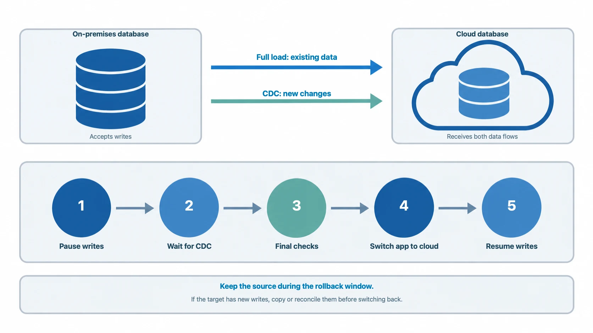

Cloud data migration involves more than copying files. Teams must choose a target, check that it works with the source, track changes during the move, and check the results. They also need to decide when applications can switch to the target. A missed dependency or an incomplete final sync can cause an outage or extra cleanup work.

This guide explains the cloud data migration process, compares common approaches, and covers costs and risks.

## What Is Cloud Data Migration?

**Cloud data migration** means moving data from a local system, another cloud, or a hosted service to the cloud. The destination may be object storage, a managed database, a data warehouse, or a data lake.

Common projects include:

- Moving an on-premises database to a managed cloud database.
- Moving data between cloud providers or regions.
- Loading operational data into a cloud data warehouse or lake for analytics.
- Replacing a legacy database while keeping applications available during the transition.

First identify what you need to move. File transfers may use storage transfer or sync services. Database migrations must also account for table structures, indexes, data rules, transactions, ongoing writes, and application connections.

## Cloud Data Migration Strategies

Choose a strategy based on the allowed downtime, data volume, how often the source changes, and whether the source works with the target. Test your choice with a pilot.

| Strategy | Consider it when | Main trade-off |
| --- | --- | --- |
| Offline | You can copy the data during planned downtime and stop writes to the source. | Simple cutover, but the application is unavailable during the final copy and checks. |
| Phased | You can move databases, applications, or business units in groups. | Limits the impact of each move, but teams must coordinate while both systems are in use. |
| Online with full load and CDC | The source must keep accepting writes, and the source, target, and tool support change capture. | Reduces downtime, but needs a consistent starting point, lag checks, validation, and a tested cutover and rollback plan. |

For an online database migration, first load the existing data. Then use change data capture (CDC) to copy new changes while the source remains active. When the target is up to date and passes the checks, schedule a short cutover window.

CDC can reduce downtime, but teams still need to plan the cutover. Monitor replication lag, check that source and target data match, and plan how to handle new writes if you need to switch back.

## Cloud Data Migration Process

### 1. Assess the source and target

List the databases and files to move, their size, growth, owners, and peak use times. Choose the cloud service and region. Check that the target supports the source database type, version, data types, and required features.

For databases, also list users and permissions, scheduled jobs, stored procedures, views, indexes, data constraints, character sets, time zones, and application connection settings.

For an online migration, record normal and peak write rates. Estimate how much change data capture (CDC) must capture and send. Record the source's normal CPU and disk use. This helps you spot any slowdown during the migration.

### 2. Map schemas and dependencies

Write down how each source table and object will map to the target. If both databases are the same type, their structures may be compatible. If they are different types, you may need to change data types, queries, indexes, or code.

List the applications, reports, scheduled jobs, and connected systems that use each set of data. Use this list to choose what to move first and what to test before each switch.

### 3. Choose a migration method

Choose an offline, phased, or online migration based on how much downtime is allowed and how often the source data changes. For an online migration, make sure the source provides a change stream or transaction log that the tool can read.

Plan how the first copy and new changes will stay in sync. Start from a consistent copy of the data and record its matching log position. This helps prevent missed or repeated changes. Check that the tool can resume from that position after a restart and reports changes it could not apply.

### 4. Prepare the cloud environment

Set up the target before moving live data. Check its capacity, storage, network, firewall, encryption, user accounts, and permissions. Size it for the expected workload and growth; do not just copy the source settings.

For moves between clouds or regions, test network speed and delay early. A small trial can reveal slow transfers, unsupported data, and unexpected transfer fees.

### 5. Run a pilot migration

Choose a sample that includes large and small tables and tables that change often. Test it under a realistic workload. Measure transfer speed and CDC latency: the time from a source write to its arrival at the target. Check both the average and P95 latency (the time within which 95% of changes arrive). Set an acceptable limit based on the application's needs. Make sure the target can keep up with new changes.

Restart replication to check that it continues from the right point without missing or repeating changes. Check how the tool reports changes it cannot apply. Use the trial to set the amount of data in each batch, how many tables to move at once, and the order of tables. Record limits and recovery steps in the runbook.

### 6. Migrate, validate, and cut over

During the first copy and CDC, monitor transfer speed, errors, changes the tool could not apply, source CPU and disk use, target capacity, and CDC latency. Compare them with the limits from the trial. Pause or slow the migration if any limit is exceeded. Then check whether the cause is the source, the network, or the target.

Before the switch, agree on when to pause writes, the allowed final delay, and when to roll back. Tell the system owners. Pause writes and wait for CDC to catch up. Check row counts or checksums, key business totals, and application behavior. A matching row count alone is not enough. Switch connections only after all checks pass. Run a brief live test before allowing writes again.

Keep the source during the rollback period. If the target has accepted new writes, moving back may require copying those changes to the source or comparing and merging the data. Test this process and assign someone to make the rollback decision.

### 7. Monitor and optimize

After the switch, monitor application errors, query speed, database capacity, data freshness, and cloud costs. Check whether the target handles the expected workload. When the new system is stable and the rollback period ends, remove the old resources according to your data retention and compliance rules.

## Cloud Data Migration Costs

Budget for more than the migration tool or service. Separate one-time migration costs from the ongoing cost of the target environment. Total costs depend on data size, migration method, data conversion work, transfer route, and how long both environments run at once.

Include the costs that apply:

- **Data transfer and network:** fees to move data out of a cloud, between regions, or over a private connection. Include repeat transfers for tests or retries.
- **Migration tools and services:** software licenses, usage fees, or outside help. Some providers bundle these costs.
- **Data preparation:** schema conversion, field mapping, and other data changes.
- **Compute and storage:** migration workers, temporary storage, and target capacity during the first copy and ongoing sync.
- **Checks and engineering:** pilots, tests, data checks, application changes, and runbooks.
- **Running both systems:** source and target costs, plus any data copying or matching needed during the rollback period.

The examples below use vendor pricing pages checked on October 27, 2026. All prices are in USD. AWS and Google Cloud publish the example totals. The BladePipe Cloud total is calculated from its published rates; it is not a vendor quote. These prices cover service or license fees, not the full project cost.

| Provider and service | Example scope | Example price | Not included |
| --- | --- | --- | --- |
| [AWS Zero-ETL to Redshift](https://aws.amazon.com/dms/pricing/) | 50 GB initial export, 10 GB resync, and 5 GB of CDC changes over 30 days from a self-managed Oracle database. | **$10.60** for the integration usage in AWS's example. | Redshift compute, storage, and I/O. |
| [Google Cloud Database Migration Service](https://cloud.google.com/database-migration/pricing) | Migration from a different database type to Cloud SQL for PostgreSQL: 600 GiB backfill and 3,000 GiB of CDC changes in one month, in Iowa. | **$5,790** for the migration service. | The destination Cloud SQL instance and other project costs. |
| [BladePipe Fully Managed](https://www.bladepipe.com/docs/price/product_price/) | 100 million rows copied, 1 million new rows synced, 100 million rows checked, and schema migration for 1,000 tables. | **About $13**, based on published rates: $1 full load + $10 incremental + $1 verification + $1 schema migration. | Source and target database charges and other project costs. |
| [BladePipe Enterprise On-Premise](https://www.bladepipe.com/docs/price/product_price/) | One licensed link running in the customer's environment for one month. | **$144** for the license, based on the published example. | Customer infrastructure and operations. |

These examples use different billing units and migration scenarios, so they are not directly comparable. To estimate your project, use pilot results and current rates. Add any costs not included in the service price.

## Common Risks and How to Reduce Them

### Incompatible schemas or database features

The target may work differently from the source or lack some features. Check compatibility, list the changes you need, and test converted objects and application queries before moving production data.

### Incomplete or inconsistent data

Finishing the data copy does not prove that the target is correct. Check tables and key business values. Review rejected records and confirm that new changes copied correctly. During CDC, include changes made while the first copy is running.

### Network bottlenecks and replication lag

Transfers may be slow because of network limits, delays, source load, or target capacity. Test the connection early. Monitor replication lag and add network or system capacity before cutover if needed.

### Cutover or rollback problems

Plan how to switch applications back and handle data written after cutover. If the target has new writes, switching back may require copying them to the source or matching the two databases. Set a rollback deadline and test the steps before the live migration.

### Security and compliance gaps

Before moving sensitive data, check who can access it, how it is encrypted, audit logs, where it is stored, and how long it must be kept. Give migration accounts only the access they need. Remove temporary access when the move is complete.

## How to Choose Cloud Data Migration Tools

When choosing a database migration tool, **first check the data size, allowed downtime, and source and target database types**.

For online migrations with little downtime, choose a tool that supports CDC (change data capture). It copies new changes while the first data load is running, which shortens the cutover window. **BladePipe** is a visual CDC platform. It supports schema migration, full migration, and ongoing sync in one task. It works with databases such as MySQL, Oracle, PostgreSQL, and SQL Server. It can support production migrations that need sync to continue until cutover.

For Azure targets, **Azure Database Migration Service** supports offline and online migration. Online migration can limit downtime to the cutover. For AWS targets, consider **AWS DMS**. Its user guide explains how to run same-type and different-type database migrations.

For SQL Server to Azure SQL migrations, **SSMA** can convert schemas from databases such as Oracle and MySQL. Choose a tool based on the source and target databases and the allowed downtime.

For a broader comparison, see our guide to [the best data migration tools](https://www.bladepipe.com/blog/data_insights/best_data_migration_tools/).

## Final Checklist

Before starting a cloud data migration, make sure you have:

- A supported way to move data from the source to the target.
- A map of database structures and connected applications.
- A migration method that fits the allowed downtime.
- A tested pilot and step-by-step runbook.
- A validation plan with clear pass or fail checks.
- Cutover and rollback steps that cover new writes.
- A cost estimate for transfer, systems, storage, tools, and running both environments.
