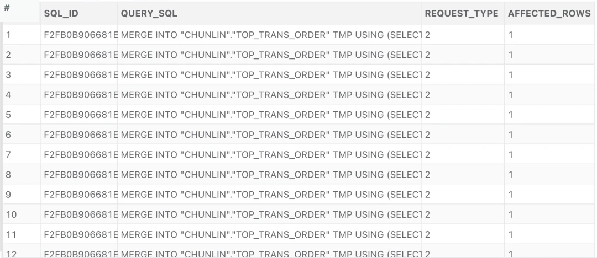
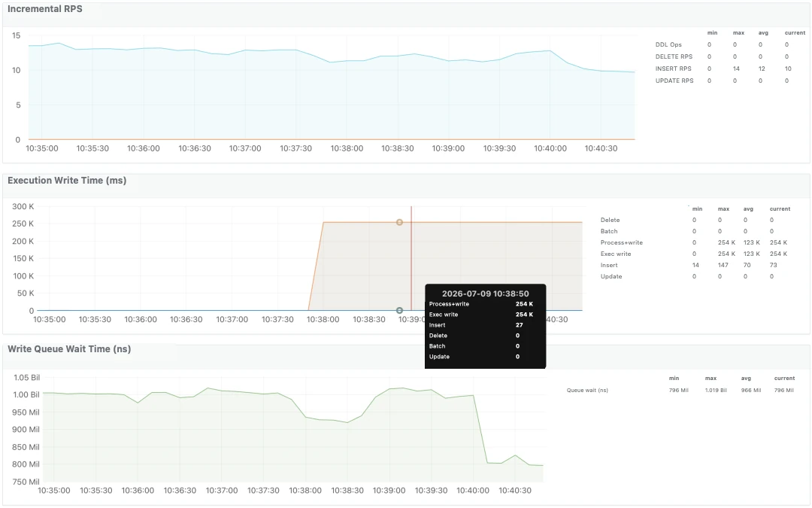
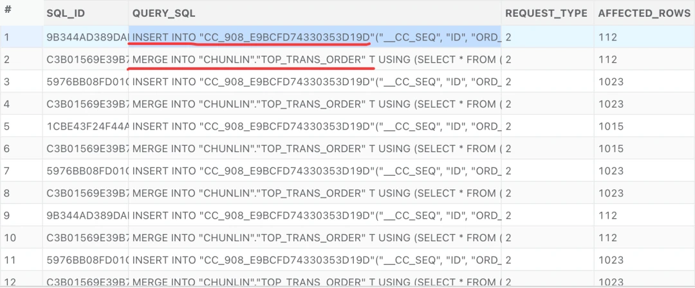
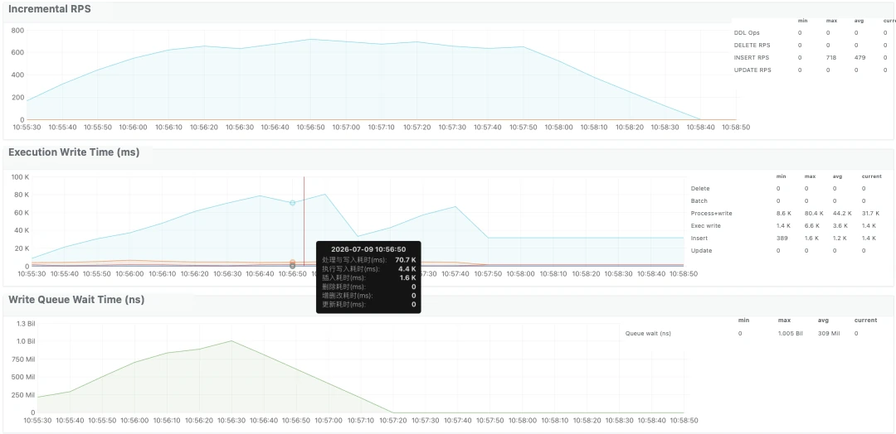
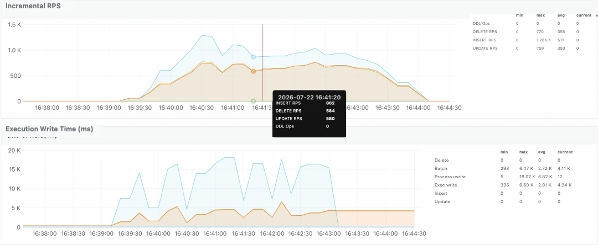

When replicating data to OceanBase in Oracle mode, enabling JDBC batching and increasing write concurrency do not always deliver the expected throughput. In one test, incremental throughput stayed near 10 rows per second (RPS), a write operation peaked at 254,000 ms, and write-queue wait time exceeded 1 billion ns. Data accumulated in the queue instead of reaching the target at the expected rate.

The issue was not simply a lack of workers. A JDBC batch does not guarantee that the database will execute a group of `MERGE` statements as one set-based operation. **BladePipe's Staging Merge mode** changes the write path: it batches rows into a staging table, then applies them to the target with set-based SQL.

In the test described below, the dashboard recorded a minimum processing-and-write duration of 8,600 ms after Staging Merge was enabled, compared with a pre-change peak of 254,000 ms. This is the roughly 30× headline comparison, but the two values are not like-for-like extremes: the post-change average for this metric was 44,200 ms. Average throughput increased to 479 RPS, with a peak of 718 RPS.

## Why Can Batch Writes Still Be Slow?

Two patterns can limit write throughput during continuous data synchronization.

### Batched `MERGE` statements may still run row by row

When a target row may already exist, a synchronizer often uses `MERGE INTO ... USING ... ON ...` to update matching rows and insert new ones. Application code may call:

```text
ps.addBatch();
ps.executeBatch();
```

This sends batched work through JDBC, but it does not by itself guarantee that the database will combine multiple statements into one set-based execution plan. In the OceanBase for Oracle case described here, investigation found the server executing many single-row `MERGE` operations. A batch of 1,024 rows could therefore result in 1,024 individual `MERGE` operations on the target.

Batch optimization depends on both client and server behavior. OceanBase documents Oracle-mode array binding and server-side batch optimization, along with configuration and statement-shape requirements. Some complex statements cannot be rewritten for batch execution. The observed behavior here is specific to the tested `MERGE` path; check the execution plan or OceanBase batch-optimization status for your own workload before concluding that a batch is running row by row. See OceanBase's [JDBC batch DML best practices](https://en.oceanbase.com/docs/common-best-practices-10000000001839082) for the relevant settings and verification methods.

**Before optimization — SQL audit:** repeated single-row `MERGE` operations against `CHUNLIN.TOP_TRANS_ORDER`, with each request affecting one row.



The result can be high per-row processing and execution overhead even when the client uses a batch API.

**Before optimization — performance dashboard:** incremental throughput stayed near 10 RPS, while processing and write duration reached 254,000 ms and queue wait exceeded 1 billion ns.



### Mixed inserts, updates, and deletes can fragment batches

Incremental changes arrive in the order recorded by source transactions and log events. A stream such as:

```text
INSERT -> UPDATE -> DELETE -> UPDATE -> INSERT
```

can split changes for the same table into many small batches grouped by operation type. A group that could otherwise be applied together may be reduced to batches of only a few or a few dozen rows. This can cause several costs to add up:

- The target repeatedly inserts, updates, deletes, or merges the same keys, probing and modifying them multiple times.
- `executeBatch()` is called more often, and the overhead of small transactions and commits accumulates.
- As batches get smaller, parameter binding and network round trips account for a larger share of total write time.

## The Approach: Stage Rows, Then Merge Them Set-Wise

Instead of relying on the database to rewrite a batch of individual `MERGE` statements, Staging Merge uses a staging table as the source for set-based target operations:

```text
Incoming changes
    -> Batch INSERT into a staging table
    -> Set-based DELETE and/or MERGE against the target table
    -> Commit and clear session-scoped staging rows
```

BladePipe first writes a batch of rows to the staging table with JDBC batch inserts. It then runs set-based SQL against the target table. For example, one `MERGE INTO target USING staging_table` can apply a batch of source rows in a single set-based operation.

This changes the work from many individual target-table `MERGE` operations to a batch insert followed by a set-based target operation. A batch of 1,024 rows that previously resulted in 1,024 single-row `MERGE` operations can instead be applied with one set-based `MERGE` from the staging table. The staging insert itself can load more than 1,000 rows in one batch in the measured setup.

**With Staging Merge enabled — SQL audit:** batched `INSERT` operations load the staging table, followed by `MERGE` operations against the target table.



### Why Use a Global Temporary Table?

An Oracle-style global temporary table (GTT) can provide a suitable source for the set-based operation:

- Its definition is visible to database sessions, while its rows are isolated to each session.
- With `ON COMMIT DELETE ROWS`, session rows are cleared at commit.

Staging Merge uses a configured schema for these tables so they can be managed centrally. BladePipe creates the required staging tables and cleans them up when the associated job is deleted.

## Performance Results

The following results are from a test with **OceanBase for Oracle (Oracle tenant mode)**. The test environment used an Alibaba Cloud ECS instance with 8 vCPUs and 16 GB of memory, a wide table with 184 columns, `writeParallel` set to 32, and `increBatchSize` set to 1,024. CPU and memory were not bottlenecks during the test.

**Before optimization (`useStagingMerge` disabled):** baseline throughput, processing and write duration, and write-queue wait.


**After optimization (`useStagingMerge` enabled):** throughput increased, and processing and write duration and queue wait decreased.



The dashboard screenshots show the following values. The duration fields below retain the dashboard's distinction between **processing and write duration** and **execution write duration**:

| Metric | Before Staging Merge | After Staging Merge |
| --- | ---: | ---: |
| Insert RPS | 12 avg; 14 max; 10 current | 479 avg; 718 max |
| Processing and write duration | 123,000 ms avg; 254,000 ms max/current | 44,200 ms avg; 8,600 ms min; 80,400 ms max |
| Execution write duration | 123,000 ms avg; 254,000 ms max/current | 3,600 ms avg; 1,400 ms min; 6,600 ms max |
| Write queue wait | 966 million ns avg; 1.019 billion ns max; 796 million ns current | 309 million ns avg; 1.005 billion ns max; 0 current |

The roughly **30×** headline comparison comes from the pre-change maximum/current duration (**254,000 ms**) and the post-change minimum processing-and-write duration (**8,600 ms**). The post-change average for that metric was **44,200 ms**; average execution write duration was **3,600 ms**. These dashboard values make clear that the headline compares different points in each run, rather than average-to-average performance.

With Staging Merge enabled:

- Average incremental throughput increased from around 10 RPS to **479 RPS**, with a peak of **718 RPS**.
- The roughly **30×** duration comparison uses the pre-change maximum/current and post-change minimum; the dashboard's min/average/max values for each duration metric are broken out above.
- Write-queue wait time, which had exceeded **1 billion ns** before the change, fell along with the write duration; data no longer accumulated in the queue in the same way.

These figures describe this specific environment and workload. Results will vary with schema width, row size, data distribution, concurrency, database configuration, and network conditions.

### Mixed I/U/D Workloads

Staging Merge can also address high-frequency mixed insert, update, and delete (I/U/D) events. BladePipe first consolidates events by primary key in memory to determine the final state, then applies the changes with two set-based statements: a `DELETE` and a `MERGE`. This avoids repeatedly probing and modifying the target table for intermediate states and reduces the overhead of many small batches and commits.

The source test for this scenario used MySQL as the source and OceanBase for Oracle as the target. The dashboard recorded average RPS of **511 for inserts**, **355 for deletes**, and **353 for updates**. Peak RPS was **1,286**, **770**, and **759**, respectively. At the chart's selected point on July 22, 2026, at 16:41:20, the tooltip showed 862 insert RPS, 584 delete RPS, and 580 update RPS. Average processing-and-write duration was **6,820 ms** (18,070 ms max), and average execution-write duration was **2,810 ms** (6,600 ms max). Average batch duration was **2,720 ms** (6,470 ms max). The same mechanism also applies to Oracle targets.

**Mixed I/U/D workload with Staging Merge enabled:** dashboard results for concurrent `INSERT`, `UPDATE`, and `DELETE` events.



## Configure Staging Merge

Staging Merge uses two parameters:

- `useStagingMerge`: enables staging-table merge writes.
- `stagingSchema`: specifies the schema where staging tables are created.

For OceanBase for Oracle targets, the mode is supported during both full migration and incremental synchronization. It is intended for workloads where batched `MERGE` writes perform poorly or mixed DML events create many small batches. The mode creates staging tables in the target database, so confirm the required permissions and schema are available before enabling it.

## Benefits and Operational Cost

Staging Merge is most useful for high-conflict batch writes, wide tables, and workloads with frequent interleaved I/U/D events. It can reduce server-side single-row `MERGE` executions and combine many small DML batches into a smaller number of set-based operations.

The trade-off is that BladePipe creates temporary tables in the configured target schema. These tables are automatically cleaned up when the associated job is deleted, so they do not require ongoing manual management.

## BladePipe Version Requirements

Staging-table merge writes were introduced in **BladePipe 1.9.0**. For **OceanBase for Oracle**, the feature is available in full migration and incremental synchronization; for **Oracle** targets, the 1.9.0 release notes list support during incremental synchronization. The feature is available in **1.9.0 and later**. BladePipe **1.12.0**, released on November 2, 2026, is the latest release as of this article's update. For new deployments, use 1.12.0 or later. Existing users can upgrade to 1.12.0 or later to get the latest fixes and improvements.

See the [BladePipe 1.9.0 release notes](/docs/releaseNote/rn-bladepipe-1-9-0) for the feature introduction and the [BladePipe 1.12.0 release notes](/docs/releaseNote/rn-bladepipe-1-12-0) for current release details.

## Get Started

If your OceanBase for Oracle target is bottlenecked by slow batch writes, try Staging Merge with a representative workload and compare throughput and write duration before and after enabling it.

- **Existing users:** [Upgrade BladePipe with Docker managed images](https://www.bladepipe.com/docs/productOP/onPremise/installation/upgrade_all_in_one_docker/) to the latest version.
- **New users:** [Install BladePipe with Docker managed images](https://www.bladepipe.com/docs/productOP/onPremise/installation/install_all_in_one_docker/).

For other deployment options, see the [BladePipe quick start guides](/docs/quick/quick_start/).
