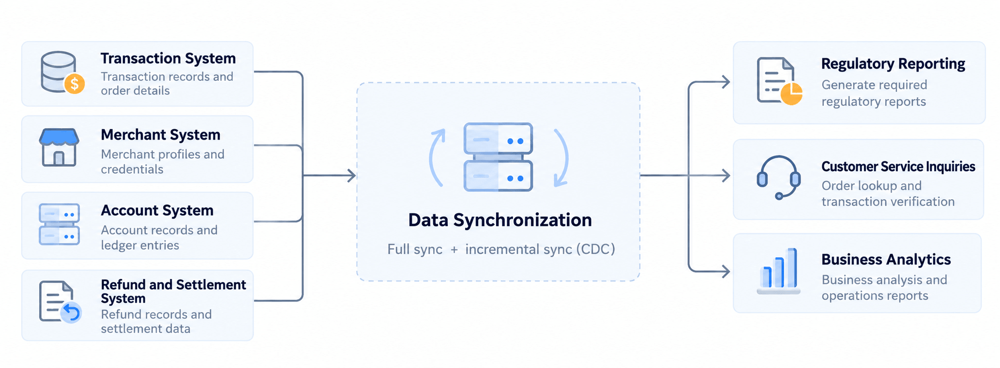
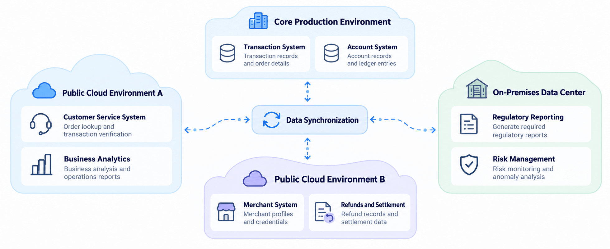

When a reporting deadline gets close, pulling the numbers together can take more work than expected. Transactions sit in one system. Merchant details, ledger entries, refunds, and settlements sit in others.

Your team has to bring those records together, match them, and investigate any differences. Support and analytics teams often need the same data. If each team builds its own extracts, the work gets repeated and the numbers may not agree.

Data synchronization for payment providers helps keep those records flowing to the systems that need them. It gives teams a shared starting point for reporting, customer queries, and analysis.

Let's look at how that works, from preparing regulatory reports to connecting workloads across clouds.

## Connect Payment Data Across Business Systems

A single payment can pass through transaction, merchant, ledger, and settlement systems. Each records part of what happened. Bringing those records together helps your team follow the payment through its full lifecycle.

Data synchronization copies records into a shared data layer or directly into downstream systems. Teams can then work from those copies instead of asking every source system for another export.

The right sync method depends on how often the data changes and how fresh it needs to be. Scheduled batch sync may be enough for small datasets that change slowly. More frequent changes may call for [change data capture (CDC)](change_data_capture_cdc.md).

After an initial data load, CDC can keep delivering committed inserts, updates, and deletes to downstream systems. This reduces the need to copy unchanged records again and again.

[BladePipe](https://www.bladepipe.com/) supports this full-load-and-CDC workflow. You can load existing records first, then keep the destination updated as the source changes. Your downstream teams still define how to match records, calculate totals, and check the results.

That distinction matters when the data is used for reporting. Having the records available gives your team more time to prepare them, but the reporting work still needs its own rules and checks.

## Prepare Regulatory Reporting Data Before the Deadline

If your team submits regulatory reports, collecting the data is only part of the job. You also need to check relationships, resolve mismatches, and review the final numbers. Starting all of that just before submission can leave little room to investigate problems.

Continuous synchronization lets you start earlier. A practical workflow looks like this:

**Source databases → Incremental sync → Reporting storage and history → Processing and validation → Review and submission**

As records arrive, your team can check whether each transaction links to the right merchant. You can also confirm that refunds have matching original payments and that settlement amounts agree with the ledger.

Finding a mismatch during the reporting period gives you time to trace it. That leaves fewer problems to solve in the final days before submission.

You also need to explain reports that have already been submitted. Suppose a customer pays in one period and receives a refund in the next. Your reporting process needs to handle both events under the applicable rules and retain the records needed to explain the result.

A current database copy may overwrite values used in an earlier report. Keep the relevant snapshots or change history, along with the calculation rules used for that period. Continuous sync alone does not preserve a reproducible reporting history.

The way you move data internally also does not determine how you submit it externally. Reporting schedules, scope, and formats still depend on the requirements that apply to your organization.

## Keep Support and Analytics Connected Across Clouds

The same data can be useful beyond reporting. Your core transaction and ledger systems may run in one environment, while support and analytics run in another cloud or your own data center.

Those teams still need transaction, refund, and settlement records. If every query goes back to the core database, it adds production load. It also creates more cross-environment connections and access permissions to manage.

With [cloud data integration](what_is_cloud_data_integration.md), you can sync selected data into the environment where it will be used. Support agents can query a local copy. Analysts can run reports without sending every query to the core database.

This works well for routine reporting and analysis that can accept some delay. Decide how fresh each copy needs to be and monitor whether it meets that requirement. Our [real-time data sync FAQ](data_sync_faq_1.md) explains why even continuous pipelines can fall behind.

For debits, available-balance checks, and settlement execution, keep validation and control in the authoritative business system. A delayed data copy could otherwise lead to an incorrect decision.

Moving data between environments also means checking how each destination protects it. Apply appropriate access controls, encryption in transit and at rest, and storage safeguards wherever the data is used.

## Use Hybrid Cloud Resources Where They Fit

Once teams can access the data they need, you have more flexibility in where their workloads run. That can help when cloud providers and on-premises infrastructure have different costs and capabilities.

Long-term commitments and discounts may lower cloud costs. For steady workloads with high utilization, existing hardware may also be economical. The better choice depends on both the resource cost and the workload.

For example, an offline analysis job or historical recalculation can often run later or be retried. Live risk monitoring and time-sensitive transaction analysis need fresher data, higher availability, and suitable recovery arrangements.

Data synchronization helps connect those environments so each team can use resources suited to its work. Depending on the setup, it can reduce costs in three areas:

- **Core database capacity.** Moving suitable reporting queries downstream can reduce production load. It may reduce the need to expand the core environment just to support analytics.
- **Repeated transfers.** Incremental sync sends changes instead of repeatedly extracting unchanged history across data centers. This can reduce duplicate data movement.
- **Development and maintenance.** Shared synchronization pipelines can reduce the separate extraction scripts and interfaces maintained by reporting, support, and analytics teams.

The pipeline also has costs, including the sync tool, target storage, network transfers, and day-to-day operations in your comparison. Whether the setup saves money depends on the costs it replaces and the costs it adds.

## Start With the Data One Team Needs

Data synchronization for payment providers can make reporting preparation and cross-cloud collaboration easier. The practical value comes from giving each team access to the records it needs, with enough time to check and use them.

[BladePipe](https://www.bladepipe.com/) supports schema migration, full data loads, and ongoing CDC synchronization across more than 60 data sources. For a concrete setup, see the guide to [creating a full-load and incremental sync pipeline](/docs/operation/job_manage/create_job/create_full_incre_task).

If your team needs a fully self-hosted setup, BladePipe also offers deployment within your own network. The [Docker installation guide](/docs/productOP/onPremise/installation/install_all_in_one_docker) walks through that option.

Start with one reporting or support workflow. Identify its source records, acceptable delay, and security needs, then compare the total cost of the proposed setup. That gives you a practical basis for deciding how to extend synchronization to other teams.
