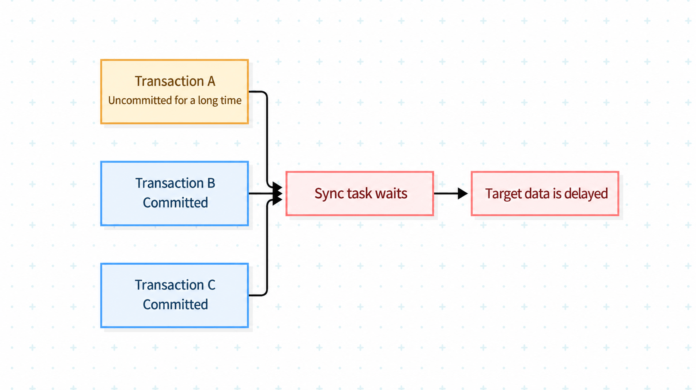
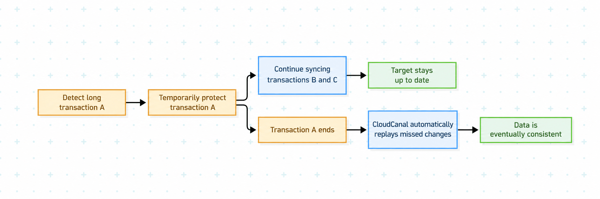
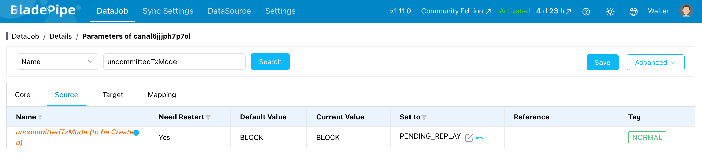

Have you ever watched your [SAP HANA](https://www.bladepipe.com/connector/sap-hana/) data replication task fall behind, even though it shows no errors? New orders are visible in your app, but the reports that use your replicated data still look the same. If that sounds familiar, a long-running transaction may be the reason.

Picture a batch job that updates old orders. It is still running, while new orders and stock changes have already been committed. Depending on how your sync task handles transactions, that unfinished batch job can hold up the later changes.

[BladePipe](https://www.bladepipe.com/) offers a way to reduce this delay for SAP HANA table-level change data capture (CDC). Its `PENDING_REPLAY` mode lets committed changes move ahead while keeping track of unfinished transactions. Once those transactions end, the task goes back and handles the pending data.

Let's walk through why this matters, how the two modes work, and when to use each one.

## Why Long Transactions Can Delay SAP HANA Data Replication

Consider three transactions in your source database:

- **Transaction A** updates old orders in bulk. It has been running for several minutes and has not committed.
- **Transaction B** adds a new order. It has committed.
- **Transaction C** updates stock levels. It has also committed.

While A is still open, the sync task does not know whether it will commit or roll back. If the task moves past A to process B and C, it must keep enough information to return to A later. Otherwise, it could miss data.

Waiting is one way to avoid that risk. BladePipe's default `BLOCK` mode waits for the earlier transaction to end before it processes later changes.

This approach is straightforward. But the longer A stays open, the longer B and C have to wait before reaching the target.

If long transactions are rare, you may barely notice the delay. If your SAP HANA workload includes frequent batch jobs, manual updates, or large data changes, that wait can become a regular problem.

## How SAP HANA CDC Can Process Committed Changes First

The other approach is to process B and C while keeping track of A. This is what `PENDING_REPLAY` does in BladePipe's SAP HANA table-level CDC mode.

When the task finds an unfinished transaction, it keeps the related data for later processing. It then continues to sync changes from transactions that have already committed.

Once the long transaction ends, the task goes back and handles the pending data automatically. You do not need to move the sync position by hand or start a new sync task to pick it up.

The long transaction still needs to finish before its final outcome can be handled. The benefit is that later committed changes can reach downstream systems without waiting for it.

For more background on table-level CDC, see our guide to [moving SAP HANA data to PostgreSQL](../tech_share/hana_pg_sync.md).

## Choosing a SAP HANA Replication Mode

The right mode depends on your workload and how quickly downstream systems need new data. `BLOCK` remains the default. `PENDING_REPLAY` is an option when long transactions cause delays and you need committed changes sooner.

| What happens? | `BLOCK` | `PENDING_REPLAY` |
| --- | --- | --- |
| A long transaction is still open | Waits for it to end | Keeps its data for later processing |
| Later transactions have committed | They wait | Their changes can sync first |
| The long transaction ends | Normal processing continues | Pending data is handled automatically |
| Typical fit | Few long transactions; waiting is acceptable | Frequent long transactions; fresher downstream data is a priority |

Before you switch, check whether long transactions are actually causing the delay. Start with one task that often falls behind. Compare its delay with the timing of long transactions in SAP HANA.

Does the delay grow while a transaction stays open? Does it drop after that transaction ends? If there is no clear link, also check target write speed, the network, and task resources.

Then test the new mode with your own business data. Check that later committed changes arrive as expected. Verify the target data after the long transaction commits or rolls back, too.

Review your target table's primary keys and how the target handles duplicate records. These checks help you confirm that the mode fits your data and downstream needs.

## How to Enable PENDING_REPLAY for SAP HANA CDC

This feature is available starting with version **1.10.0**. When you create or edit a task with SAP HANA as the source:

1. Use **table-level CDC** mode.
2. Open the source's advanced settings.
3. Change `uncommittedTxMode` from `BLOCK` to `PENDING_REPLAY`.
4. Check the target's primary keys and duplicate handling settings.

Existing tasks keep their current behavior unless you change the setting. A version upgrade does not switch the mode automatically.

## Keeping SAP HANA Data Replication Moving

A long transaction does not have to hold up every later change. With `PENDING_REPLAY`, committed data can keep moving while BladePipe tracks unfinished work and handles it once the transaction ends.

If your reports fall behind during batch updates, financial close, or stock adjustments, start by checking for long transactions. Then test the mode on one affected task and compare both delay and data accuracy.

## SAP HANA Long Transaction FAQ

### Does a long transaction always delay later committed changes?

It depends on how the sync task handles unfinished transactions. In BladePipe's `BLOCK` mode, later changes wait. With `PENDING_REPLAY`, later committed changes can sync while the task keeps the unfinished transaction's data for later processing. This option applies to SAP HANA table-level CDC.

### Do I need to replay pending data manually?

No. In `PENDING_REPLAY` mode, the task returns to the pending data automatically after the long transaction ends. You do not need to adjust the sync position by hand. When testing the mode, check the target results for both committed and rolled-back transactions.

### Will an upgrade change my existing tasks?

No. Existing tasks keep their current behavior unless you update their settings. `BLOCK` remains the default. To use the new mode, select table-level CDC and set `uncommittedTxMode` to `PENDING_REPLAY` in the source's advanced settings. Test the change with your workload before applying it more widely.