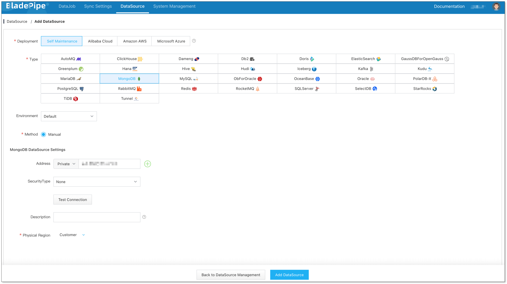
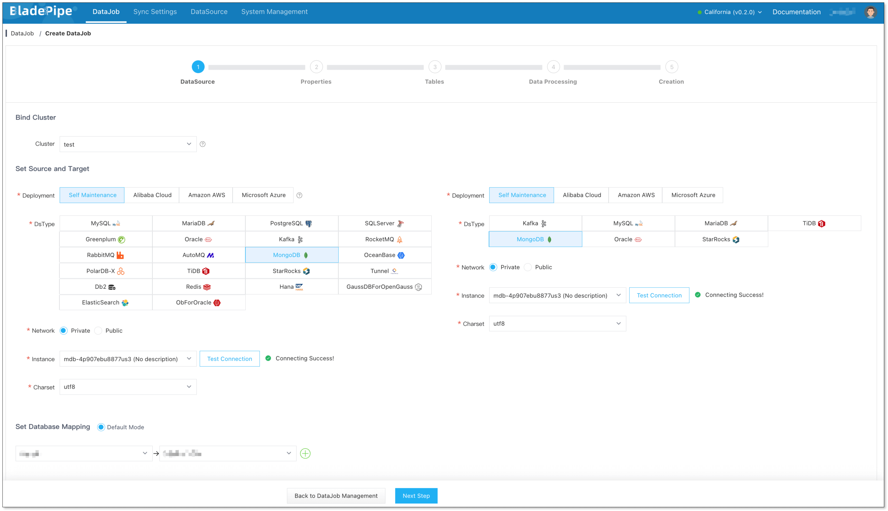
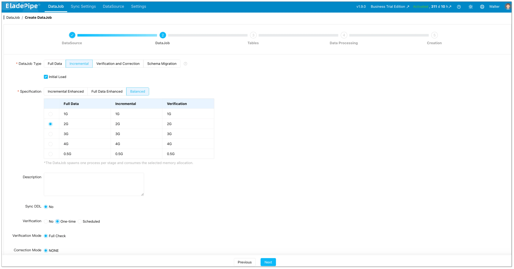
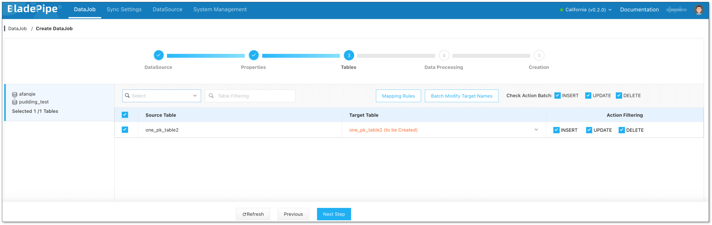
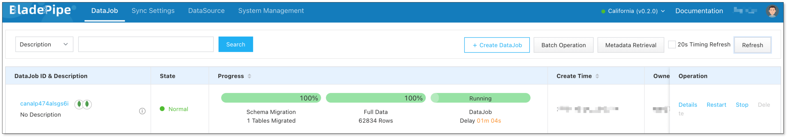

When moving a MongoDB workload to a new cluster, you may copy data from the current source, keep the target updated, and then cut over. If both clusters must accept writes, changes need to flow in both directions.

BladePipe added MongoDB-to-MongoDB two-way sync in version 1.11.0.

<!-- truncate -->

## What does MongoDB two-way sync mean?

In a one-way pipeline, one MongoDB deployment is the source of changes and another is the target:

```text
MongoDB A  -------------------->  MongoDB B
           changes flow one way
```

In a two-way setup, each deployment can send changes to the other:

```text
MongoDB A  <------------------>  MongoDB B
              changes flow both ways
```

## When is two-way sync useful?

Two-way sync may fit architectures where both deployments need to receive changes, such as:

- **Regional operations:** Applications in more than one region write locally and need data updates to move between clusters.
- **Staged transitions:** Teams move workloads between environments while keeping changes flowing during a transition period.
- **Distributed data workflows:** Separate systems or locations own different parts of the workload but need selected collections synchronized.

If only one deployment should accept writes, a one-way full load plus incremental sync is sufficient. Two-way sync adds coordination requirements, so use it only when both directions need to exchange changes.

## Two problems to plan for: loops and write conflicts

### Replication loops

If a change from MongoDB A is copied to MongoDB B, the B-to-A pipeline may see that copied change and send it back. Without loop prevention, the same change can circulate repeatedly.

BladePipe prevents this loop with a transaction marker. When it writes a change to the target, it writes a marker and the business document in the same MongoDB transaction. The reverse pipeline can identify the transaction and filter out the replicated change. This is separate from application-level conflict handling.

### Concurrent writes to the same document

Loop prevention does not determine which value should win when applications update the same document on both sides around the same time. That is a data ownership and conflict policy question.

Before enabling application writes on both clusters, decide how the application prevents or resolves concurrent edits. Options may include assigning ownership by collection, tenant, or document key, or defining an application-level conflict rule. Test that policy with realistic workloads.

## How a MongoDB two-way pipeline is organized

MongoDB incremental sync uses Change Streams in BladePipe. The source deployment and account must meet the requirements for Change Streams, and the target account needs permission to apply writes. Review the [MongoDB permissions guide](https://www.bladepipe.com/docs/dataMigrationAndSync/datasource_func/MongoDB/privs_for_mongo/) before setup.

The two-way topology uses one DataJob for each direction:

```text
DataJob 1: MongoDB A  --------------------> MongoDB B
DataJob 2: MongoDB B  --------------------> MongoDB A
```

## Tutorial: Create a MongoDB two-way sync in BladePipe

In this example, **MongoDB A** contains the initial data and **MongoDB B** is empty or has already been reconciled with A. If both clusters contain independent production data, reconcile their collections and document IDs before starting; do not use two full loads to merge them.

The current version matrix lists MongoDB 3.x through 8.x; check [supported DataSource versions](https://www.bladepipe.com/docs/dataMigrationAndSync/datasource_version/) for current compatibility details.

### Before you start

- Choose the Worker setup for your deployment: **On-Premise** installs include a Worker with the Console, so you do not need to install one separately. For **BYOC**, install a Worker on your infrastructure using [Docker](https://www.bladepipe.com/docs/productOP/byoc/installation/install_worker_docker/) or [Binary](https://www.bladepipe.com/docs/productOP/byoc/installation/install_worker_binary/). In **Managed** mode, BladePipe manages the Worker. In every mode, the Worker running the DataJobs must be able to connect to both MongoDB deployments. See the [On-Premise Quickstart](https://www.bladepipe.com/docs/quick/quick_start/), [BYOC Quickstart](https://www.bladepipe.com/docs/quick/quick_start_byoc/), or [Managed Quickstart](https://www.bladepipe.com/docs/quick/quick_start_mgr/) for your deployment.
- Use a MongoDB deployment that supports both Change Streams and multi-document transactions. Standalone deployments are not supported for this two-way workflow. Replica sets are supported; validate sharded clusters with your sharding topology and connect through `mongos`. AWS DocumentDB is not supported for MongoDB two-way sync.
- Prepare accounts with permissions to read and subscribe to changes on the source, write target documents, and access the anti-loop collection. See [Required Privileges for MongoDB](https://www.bladepipe.com/docs/dataMigrationAndSync/datasource_func/MongoDB/privs_for_mongo/).
- Check network routes, firewall rules, and TLS settings between the Worker and both deployments.

### Prepare the anti-loop collection on both MongoDB instances

Connect to **each** MongoDB instance and create the helper collection and TTL index:

```javascript
use cloudcanal

db.createCollection("__cc_tx_de_cycle")

db.__cc_tx_de_cycle.createIndex(
  { expireAt: 1 },
  {
    name: "__cc_expire_at",
    expireAfterSeconds: 0
  }
)
```

The default full name is `cloudcanal.__cc_tx_de_cycle`. Create it on both instances, because each one acts as both a source and a target. Do not add this collection to the business collection mapping or insert marker documents manually; BladePipe writes markers as part of sync transactions.

### Step 1: Add both MongoDB deployments

In BladePipe, go to **DataSource** > **Add DataSource**. Select **MongoDB**, enter the connection details for MongoDB A, and click **Test Connection**. Give the DataSource a clear name such as `MongoDB-A` and save it. Repeat for MongoDB B, naming it `MongoDB-B`.



### Step 2: Create the initial A-to-B DataJob

1. Go to **DataJob** > **Create DataJob**.
2. Select the Worker cluster for the task. Set **MongoDB-A** as the source and **MongoDB-B** as the target, then click **Test Connection** for both.
3. Click **Next** to open the DataJob properties.



4. Select **Incremental** as the DataJob type and enable **Initial Load**. This loads the existing documents from A and then continues to capture changes.
5. Select an appropriate specification for your data volume and expected change rate. Turn off **Start Automatically** so you can set the anti-loop parameters before the job starts.
6. Select the collections to synchronize.
7. Review the configuration and create the DataJob.





After creation, open the DataJob details and choose **Functions** > **Modify DataJob Params**. Configure the following values, then save and start the job:

**Source tab**

| Parameter | Value |
| --- | --- |
| `captureMode` | `CHANGE_STREAM` |
| `deCycle` | `true` |
| `deCycleCollection` | `cloudcanal.__cc_tx_de_cycle` |
| `deCycleTransactionCacheSize` | `10000` (default) |

**Target tab**

| Parameter | Value |
| --- | --- |
| `deCycle` | `true` |
| `deCycleCollection` | `cloudcanal.__cc_tx_de_cycle` |
| `deCycleMarkerTtlDays` | `7` (default) |
| `enableBatchApply` | `false` |

Wait for the full load to finish. Confirm that the incremental stage is running and that its latency is acceptable before continuing.

### Step 3: Create the reverse B-to-A DataJob

Once the initial load has finished and A-to-B incremental sync is running, create a second DataJob for the opposite direction:

1. Go to **DataJob** > **Create DataJob**.
2. Set **MongoDB-B** as the source and **MongoDB-A** as the target, then test both connections.
3. Select **Incremental** and leave **Full Data / Initial Load** unchecked. B already received the baseline from A; starting a second full load could overwrite existing documents.
4. Select the collections that should flow back to A. Keep the scope consistent with the A-to-B DataJob for a symmetric setup.
5. Turn off **Start Automatically**, review the configuration, and create the DataJob.
6. In **Functions** > **Modify DataJob Params**, set the same anti-loop values for the reverse direction: `captureMode=CHANGE_STREAM`, `deCycle=true` on both source and target, `deCycleCollection=cloudcanal.__cc_tx_de_cycle`, source `deCycleTransactionCacheSize=10000`, target `deCycleMarkerTtlDays=7`, and target `enableBatchApply=false`.
7. Save the parameters and start the reverse DataJob. Start it before allowing applications to write to B.

Set the marker retention period longer than the maximum task downtime, backlog, and position rollback window your operations allow. If you use a different helper collection name, set the matching fully qualified `database.collection` value in both jobs.

### Step 4: Verify changes in both directions

Use a test collection or safe test documents. Avoid using one document for simultaneous writes during this check.

1. Insert, update, and delete a test document on A. Confirm the changes appear on B and that the A-to-B DataJob processes them.
2. Repeat with a different test document on B. Confirm the changes appear on A and that the B-to-A DataJob processes them.
3. Check both DataJob detail pages for normal status, incremental progress, and acceptable latency.
4. Only after these checks pass, enable the planned application write traffic on both clusters.



## Two-way sync vs. MongoDB replica sets

| | MongoDB replica set | BladePipe MongoDB two-way sync |
| --- | --- | --- |
| Main purpose | High availability and redundant members in a replica set | Move selected data between distinct deployments in both directions |
| Data flow | MongoDB-managed replication within the replica set | CDC pipelines between source and target DataSources |
| Use when | Add redundancy or recover from node failure | Synchronize separately operated clusters or environments |
