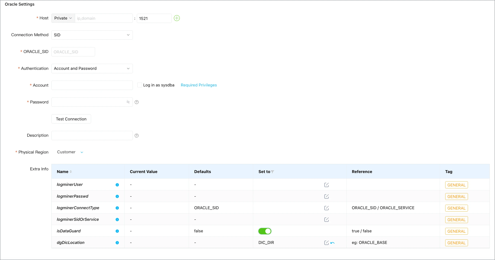
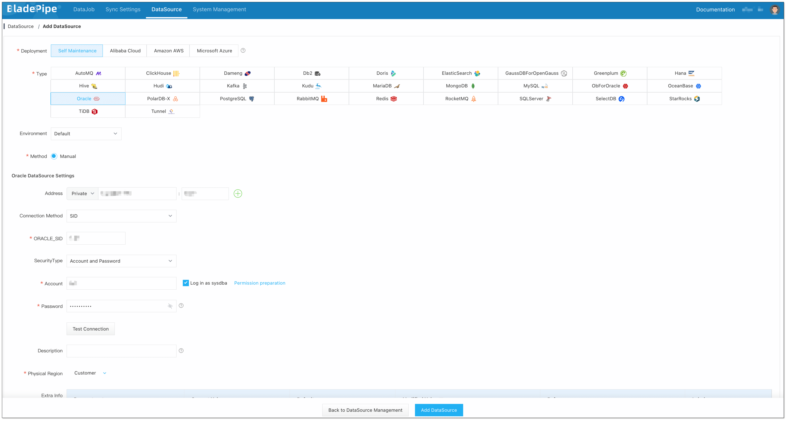
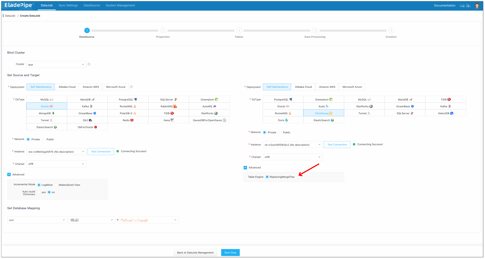
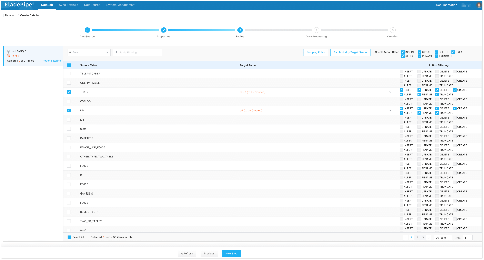
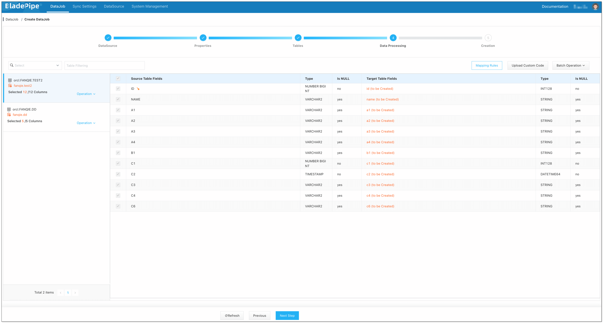
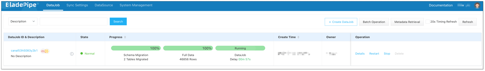

This tutorial explains how to use an Oracle Data Guard standby as the source for database synchronization with BladePipe. It covers LogMiner preparation, source configuration, DataJob creation, and validation. ClickHouse is used only as the example target; the standby-side setup applies to other supported targets. For architecture, RAC archive handling, dictionary refresh, and recovery details, see [Oracle CDC from a Data Guard Standby](../data_insights/oracle_cdc_from_dataguard_standby_database.md).

```text
Applications → Oracle primary
                  │ redo transport
                  ▼
        Oracle Data Guard standby
                  │ archived redo logs
                  ▼
             BladePipe CDC → ClickHouse (example target)
```

## Before You Start

- An Oracle Data Guard standby that is receiving redo from the primary.
- Network access from the BladePipe Worker to the standby listener and ClickHouse.
- An Oracle account with the catalog, LogMiner, and table permissions required for the selected schemas. Complete the standard Oracle CDC prerequisites, including ARCHIVELOG mode and supplemental logging, using the [LogMiner preparation guide](/docs/dataMigrationAndSync/datasource_func/Oracle/prepare_for_oracle_logminer/).
- ClickHouse connection details and a database for the replicated tables.

Ask the DBA to check the standby role and open mode on the standby, then check archive and supplemental logging on the primary:

```sql
-- Run on the standby
SELECT database_role, open_mode FROM v$database;

-- Run on the primary
SELECT log_mode,
       supplemental_log_data_min AS min_log,
       supplemental_log_data_pk AS pk_log,
       supplemental_log_data_ui AS unique_log,
       supplemental_log_data_all AS all_log
FROM v$database;
```

Confirm the standby is in its expected role and supports the queries required by the task. The primary should use `ARCHIVELOG`; the supplemental logging query should show `YES` or `IMPLICIT` for a relevant field. If either setting needs to change, follow the version-specific steps in the [LogMiner preparation guide](/docs/dataMigrationAndSync/datasource_func/Oracle/prepare_for_oracle_logminer/). Also confirm redo apply is running and archived logs will be retained through the initial load and recovery window. Apply delay adds to CDC latency. See [Oracle privileges for synchronization](/docs/dataMigrationAndSync/datasource_func/Oracle/privs_for_oracle/) for account permissions.

## Step 1: Prepare the Standby for a LogMiner Dictionary

BladePipe's Data Guard mode uses a flat-file LogMiner dictionary. Create a physical directory on the standby database server as the Oracle installation user:

```shell
su - oracle
mkdir -p /u01/app/oracle/dic
```

For Oracle 19c, create an Oracle directory object for that path and grant access:

```sql
CREATE DIRECTORY DIC_DIR AS '/u01/app/oracle/dic';
GRANT READ, WRITE ON DIRECTORY DIC_DIR TO PUBLIC;

SELECT * FROM SYS.DBA_DIRECTORIES WHERE DIRECTORY_NAME = 'DIC_DIR';
```

`DIC_DIR` is an example name; use your actual Oracle directory object name in BladePipe. The documented example grants access to `PUBLIC`; have the DBA confirm this scope meets your security policy before applying it.

For Oracle 11g, the BladePipe preparation guide also calls for setting `utl_file_dir` and restarting the database:

```sql
ALTER SYSTEM SET utl_file_dir='/u01/app/oracle/dic' SCOPE=SPFILE;
```

The parameter takes effect after a restart; coordinate this change with the DBA.

## Step 2: Build and Verify the Dictionary File

Connect to the standby with an account that can execute `DBMS_LOGMNR_D` and build the dictionary:

```sql
BEGIN
  DBMS_LOGMNR_D.BUILD(
    dictionary_filename => 'logminer_dict.ora',
    dictionary_location => 'DIC_DIR',
    options => DBMS_LOGMNR_D.STORE_IN_FLAT_FILE
  );
END;
/
```

Verify that `logminer_dict.ora` exists under `/u01/app/oracle/dic` and is readable by Oracle.

## Step 3: Add the Oracle Standby and ClickHouse Target

In BladePipe, go to **DataSource** > [**Add DataSource**](/docs/operation/datasource_manage/add_self_maintain_ds/) and add Oracle and ClickHouse.

For Oracle, enter the standby listener, service, and credentials. In the Oracle DataSource's **Additional Parameters**, add:

| Parameter | Value | Purpose |
| :--- | :--- | :--- |
| `isDataGuard` | `true` | Enables Oracle Data Guard standby mode. |
| `dgDicLocation` | `DIC_DIR` | Oracle `DIRECTORY` object containing the flat-file dictionary; must match its name exactly. |



Test the connection from the Worker that will run the DataJob. This confirms network access and login, not archive availability. If successful, click **Add DataSource**.

For ClickHouse, enter the host, port, database, and credentials, test the connection, and click **Add DataSource**.



In the ClickHouse DataSource's **Advanced** settings, choose **ReplacingMergeTree** or **ReplicatedReplacingMergeTree** as the table engine.



## Step 4: Create a Full-Load-Plus-Incremental DataJob

For the validation example, create a small test table on the Oracle primary before opening the DataJob wizard, so it is available to select:

```sql
CREATE TABLE DG_CDC_DEMO (
  ID NUMBER(10) PRIMARY KEY,
  NOTE VARCHAR2(100)
);
```

BladePipe creates the corresponding ClickHouse table during schema migration.

Go to **DataJob** > [**Create DataJob**](/docs/operation/job_manage/create_job/create_full_incre_task/), then:

1. Select the standby Oracle DataSource as the source and choose the target DataSource.
2. Select **Incremental** and enable **Full Data** to load existing rows before ongoing change capture.
3. Select schemas and tables. Check keys and permissions needed to capture updates and deletes.

   

4. Review column selection, target mappings, and data types.

   

5. Set the DataJob specification based on table size and expected change volume, then create the DataJob.

   BladePipe creates the schema, full-load, and incremental tasks for the pipeline.

   

## Step 5: Verify the Pipeline

Test with a controlled table before onboarding production workloads:

1. Confirm the DataJob completes its schema and full-load tasks.
2. On the Oracle primary, insert a test row and commit:

   ```sql
   INSERT INTO DG_CDC_DEMO (ID, NOTE) VALUES (1, 'CDC insert');
   COMMIT;
   ```

3. Wait for redo to apply on the standby, then confirm the row appears in ClickHouse. This query assumes the example table and column names are preserved; adjust them if your DataJob mapping changes names:

   ```sql
   SELECT ID, NOTE
   FROM your_database.DG_CDC_DEMO FINAL
   WHERE ID = 1;
   ```

4. Update the same row on the Oracle primary and commit:

   ```sql
   UPDATE DG_CDC_DEMO SET NOTE = 'CDC update' WHERE ID = 1;
   COMMIT;
   ```

   Confirm the updated value appears in ClickHouse, then delete the row on Oracle and commit:

   ```sql
   DELETE FROM DG_CDC_DEMO WHERE ID = 1;
   COMMIT;
   ```

   Re-run the ClickHouse query; it should return no row.

5. Check the DataJob's incremental status, latency, and error messages in the console.

For production, compare row counts and run a [verification DataJob](/docs/operation/job_manage/create_job/create_period_verification_correction_job/) on representative tables.

ClickHouse's ReplacingMergeTree merges row versions asynchronously. Use `FINAL` for ad hoc queries that need the current row state.

## Operational Checks Before Production

- Monitor archive retention and standby redo apply delay during operation.
- For RAC or multiple archive destinations, confirm all required logs are accessible. Set `archiveDestName` when you need to specify archive destinations.
- Keep the flat-file dictionary aligned with schema changes. See the [Data Guard CDC guide](../data_insights/oracle_cdc_from_dataguard_standby_database.md) for refresh options.
- After a switchover or service change, verify that the DataSource points to the intended standby before resuming.

## Troubleshooting

### The Oracle DataSource connection test fails

Check listener, service name, firewall, credentials, and Worker network access. If the standby cannot support the required connection mode, consult the DBA.

### The dictionary file cannot be created or found

Confirm the path exists, the Oracle directory object points to it, and Oracle can write there. Check that `dgDicLocation` names that object, not the filesystem path.

### The DataJob reports missing or discontinuous archived logs

Check standby apply, archive retention and destinations, and whether a required sequence was purged. For RAC, confirm all redo threads are accessible.

### The target is behind the primary

Compare Data Guard apply delay with BladePipe latency, then check DataJob errors and target backpressure.
